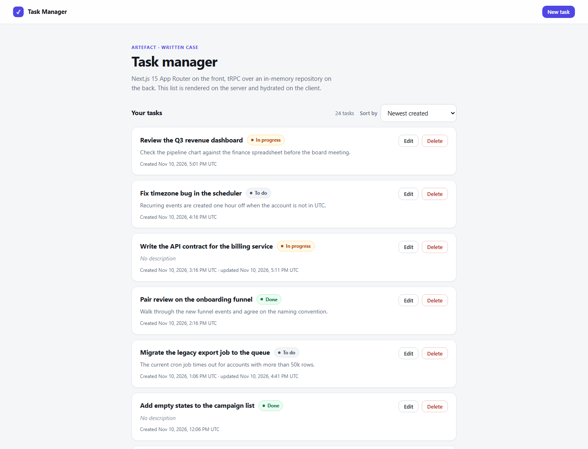

# Artefact written case — Task Manager

A small task manager built for the **Software Engineer (Senior, Brazil)** written case:
**Next.js 15 App Router** on the front, **tRPC** over an **in-memory repository** on the back,
with server-side rendering on the list page and an infinite-scroll bonus.

> The full written answers (theory + practical) are in [`docs/answers`](docs/answers).
> `npm run submission` turns this README and those answers into two PDFs; the output is
> not committed on purpose — it contains personal data.



---

## Stack

| Layer         | Choice                                                     | Version       |
| ------------- | ---------------------------------------------------------- | ------------- |
| Framework     | Next.js (App Router)                                       | 15.5.29       |
| UI            | React / React DOM                                          | 19.3          |
| API           | tRPC + TanStack React Query integration                    | 11.27 / 5.107 |
| Validation    | Zod (shared by server and form)                            | 4.6           |
| Serialization | superjson (keeps `Date` intact on the wire and across RSC) | 2.2           |
| Tests         | Vitest                                                     | 3.2           |
| Language      | TypeScript (strict)                                        | 5.9           |
| Monorepo      | npm workspaces                                             | npm 10+       |

## How to run

```bash
# Node 22+ (see .nvmrc)
npm install
npm run dev          # http://localhost:3000
```

Production mode:

```bash
npm run build
npm start
```

Docker:

```bash
docker compose up --build   # http://localhost:3000
```

Quality gate (the same command CI runs):

```bash
npm run verify       # lint -> format:check -> typecheck -> test -> build
```

Submission documents (needs Chrome or Edge installed):

```bash
npm run submission   # docs/answers + README -> PDF, written to submission/
```

## Architecture

```
┌──────────────────────────────────────────────────────────────────────┐
│ frontend/  (Next.js 15, App Router)                                  │
│                                                                      │
│ app/page.tsx ── server component ── prefetch + HydrateClient         │
│ app/tasks/new ─┐                                                     │
│ app/tasks/[id]/edit ─┴─ server component ── caller.tasks.getById     │
│ components/* ── client components ── useInfiniteQuery / useMutation  │
│ app/api/trpc/[trpc]/route.ts ── fetch adapter (only HTTP surface)    │
└────────────────────────────────┬─────────────────────────────────────┘
                                 │ imports (workspace package, type-safe)
┌────────────────────────────────▼─────────────────────────────────────┐
│ backend/  (@artefact/backend — no Next.js dependency)                │
│                                                                      │
│ router.ts ── tasks router + health                                   │
│ trpc.ts   ── initTRPC, superjson, error formatter, timing            │
│ context.ts ── per-request context (repository injection)             │
│ modules/tasks/                                                       │
│   task.constants.ts  limits and sort values (Zod-free)               │
│   task.schema.ts     Zod inputs, entity schema, field errors         │
│   task.router.ts     list / getById / create / update / delete       │
│   task.repository.ts TaskRepository port + in-memory adapter         │
└──────────────────────────────────────────────────────────────────────┘
```

The backend is a **package, not a process**: the router has no knowledge of Next.js and receives
its repository through the context. Mounting it on Fastify/Express later is a ~20-line adapter,
and the server components call it **in-process** — no HTTP round trip to your own API on SSR.

## API

Single endpoint: `POST|GET /api/trpc/*` (fetch adapter). Procedures:

| Procedure       | Type     | Input                                                       | Errors                     |
| --------------- | -------- | ----------------------------------------------------------- | -------------------------- |
| `tasks.list`    | query    | `{ limit?: 1..50 (default 8), cursor?: string, sort? }`     | `BAD_REQUEST`              |
| `tasks.getById` | query    | `{ id }`                                                    | `NOT_FOUND`                |
| `tasks.create`  | mutation | `{ titulo, descricao?, status? }`                           | `BAD_REQUEST`              |
| `tasks.update`  | mutation | `{ id, titulo?, descricao?, status? }` (at least one field) | `BAD_REQUEST`, `NOT_FOUND` |
| `tasks.delete`  | mutation | `{ id }`                                                    | `NOT_FOUND`                |
| `health`        | query    | —                                                           | —                          |

Field names (`titulo`, `descricao`, `dataCriacao`, `dataAtualizacao`) follow the case specification;
everything else in the codebase is in English. `dataCriacao` and `dataAtualizacao` are real `Date`
objects on both sides (superjson). A task starts with both timestamps equal, and every update bumps
`dataAtualizacao` without touching `dataCriacao`.

`sort` accepts `created-desc` (default), `created-asc`, `updated-desc`, `titulo-asc` and `status-asc`;
an unsupported value is a `BAD_REQUEST`. Every order is a total order with the task id as tiebreaker,
so two pages never disagree about the position of equal timestamps.

Pagination is **keyset**: `nextCursor` is the id of the last item, and the next page starts after
it. With `offset/take`, deleting a row between two requests would skip an item; with a cursor the
only consequence is that a deleted cursor restarts from the first page.

## What is implemented

- **SSR list** — `app/page.tsx` prefetches the first page in a server component, dehydrates the
  cache and hydrates the client component. `dynamic = 'force-dynamic'` because the in-memory store
  changes per request (otherwise Next would serve build-time HTML).
- **Ordering** — creation (both directions), last update, title and status. The order lives in the
  URL (`/?sort=updated-desc`), so the server prefetches exactly that view, the page is shareable and
  the change is a `startTransition` navigation instead of a client-side reshuffle.
- **Infinite scroll** — TanStack `useInfiniteQuery` + `IntersectionObserver` sentinel with
  `rootMargin: 240px`; the sentinel only exists while `hasNextPage` is true.
- **Delete with feedback** — inline two-step confirmation (no `window.confirm`), per-row pending
  state, success/error toasts, and query invalidation of every cached page.
- **Create / edit** — plain hooks (`useTaskForm`), validation with the same Zod schema the API uses,
  server-side field errors merged back into the form, loading state on submit, redirect + toast.
- **Errors** — `NOT_FOUND` for missing tasks, `BAD_REQUEST` with `fieldErrors` for invalid input,
  stacks stripped in production, `TRPCClientError` normalised into one readable message.
- **States** — loading skeleton, empty state, error state with retry, end-of-list marker.
- **Seed** — 24 fictional tasks so pagination and the infinite scroll are visible immediately.

## Decisions and trade-offs

| Decision                                                  | Why                                                                                                    | Cost                                                                                       |
| --------------------------------------------------------- | ------------------------------------------------------------------------------------------------------ | ------------------------------------------------------------------------------------------ |
| Backend as a workspace package instead of a second server | One command to run, no CORS, SSR calls the router in-process, but the domain still has a hard boundary | Backend isn't independently deployable _today_ (the router already is transport-agnostic)  |
| tRPC instead of REST                                      | End-to-end types with zero codegen; the same Zod schema validates the form and the API                 | Not consumable by non-TypeScript clients; one URL makes per-resource CDN caching unnatural |
| Zod as the single source of validation                    | No rule drift between client and server                                                                | The schema ships to the client (~13 KB gzipped)                                            |
| superjson                                                 | `dataCriacao` stays a `Date` instead of a stringly-typed field                                         | Small payload overhead                                                                     |
| Keyset pagination                                         | Correct under concurrent deletes                                                                       | Cursor is opaque to the UI                                                                 |
| Sort per request                                          | One comparator covers every order, no extra indexes                                                    | Editing an item between two pages can move it out of the current cursor window             |
| In-memory repository behind an interface                  | The case does not need a database; the domain does not care either                                     | Data resets on restart, single instance only                                               |
| Hand-written CSS                                          | No build step or extra dependency for a case this size                                                 | No utility classes for future screens                                                      |
| `npm` workspaces with TypeScript sources                  | No build/watch step for the backend package                                                            | Consumers need `transpilePackages` (configured)                                            |

## Tests

```bash
npm test        # vitest run in both workspaces
```

**33 backend tests.** Twenty-nine of them drive the real router with an injected repository (no HTTP,
no mocks of the code under test); four go through the same `fetchRequestHandler` adapter the app
mounts, which is the only way to verify what the wire actually promises: `dataCriacao` and
`dataAtualizacao` as `Date` objects (superjson), `fieldErrors` on `BAD_REQUEST`, and a production
`INTERNAL_SERVER_ERROR` that leaks neither message nor stack. They cover creation with trimmed title
and normalised description, both length boundaries, an unknown status, keyset pagination with
ordering and no duplicates, an unknown cursor, the default page size, partial updates, the update
timestamp, every sort order, `NOT_FOUND` on update/delete/getById, defensive copies, and the 24
seeded tasks.

**13 frontend tests** cover the pure logic behind the list, the form and the error handling: the sort
parser (including unknown values in the URL), the shared list input, the field-error mapping and
message extraction from a `TRPCClientError`.

The production build was also smoke-tested end to end (create → update → list → delete → double delete →
empty title), including the SSR HTML assertion that seeded tasks are present in the first response.

## What I would do next

Persistence (Postgres + a second `TaskRepository`), authentication in `createContext` (the HTTP context
already carries the request headers; the RSC caller would resolve them with `next/headers`), per-procedure
rate limiting, optimistic updates on delete, Playwright for the critical flow, OpenTelemetry spans
instead of the timing `console.info`, and a `/tasks/[id]` detail route.

## Repository layout

```
backend/    domain + tRPC router (no Next.js dependency)
frontend/   Next.js app: route handler, server components, client components
docs/
  answers/          written answers (Part 1 and Part 2)
  screenshots/      images used by the README and by the PDFs
scripts/            submission PDF builder (Markdown -> HTML -> Chrome headless)
submission/         generated PDFs + screenshots (gitignored)
```
