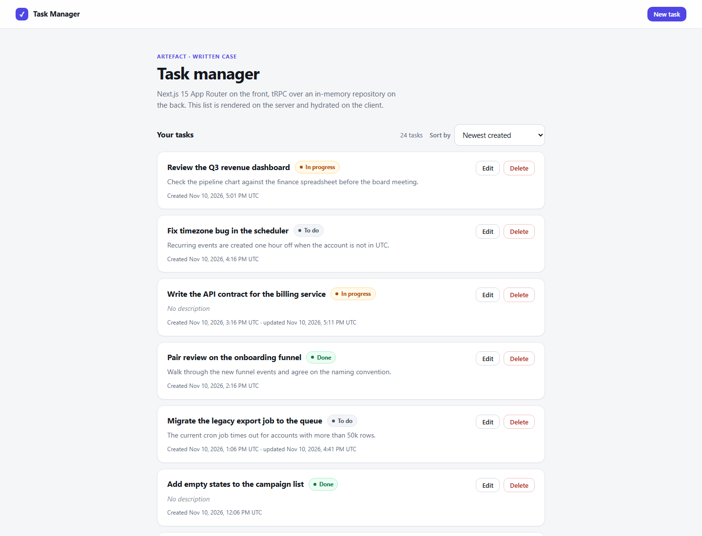
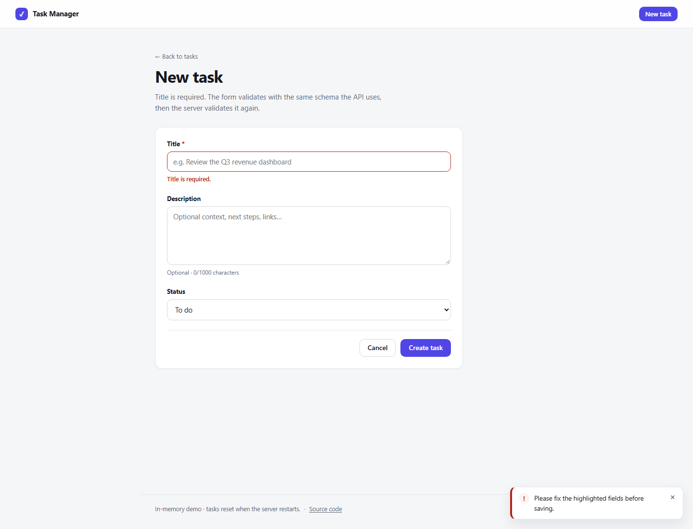
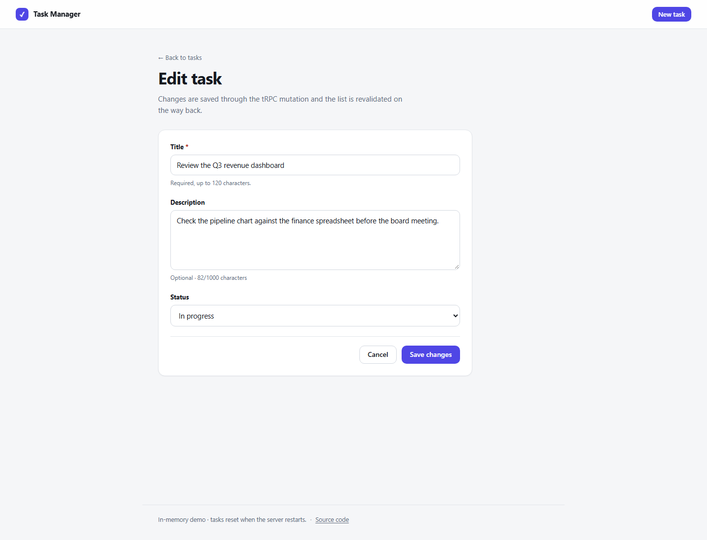
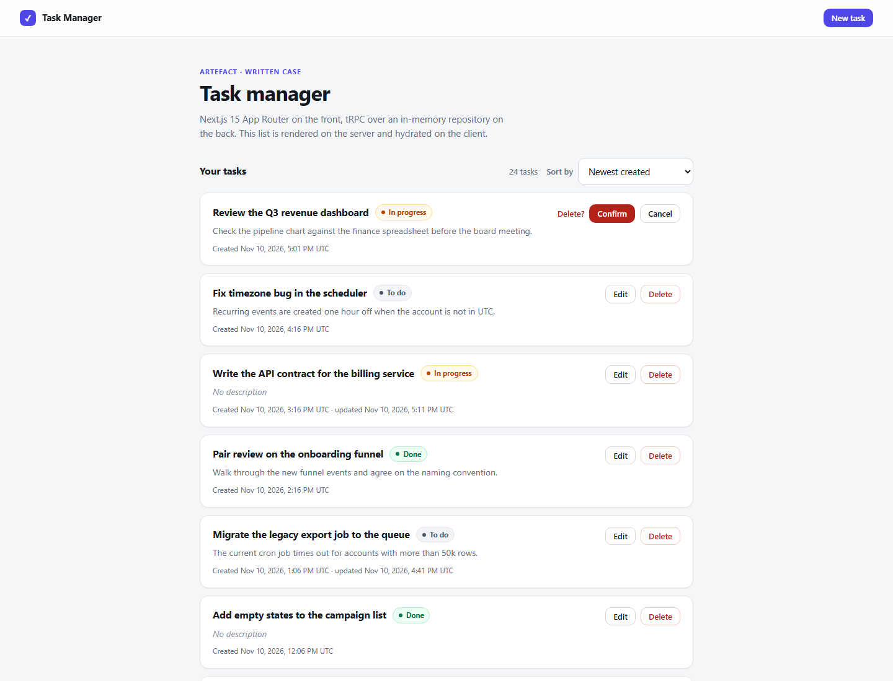
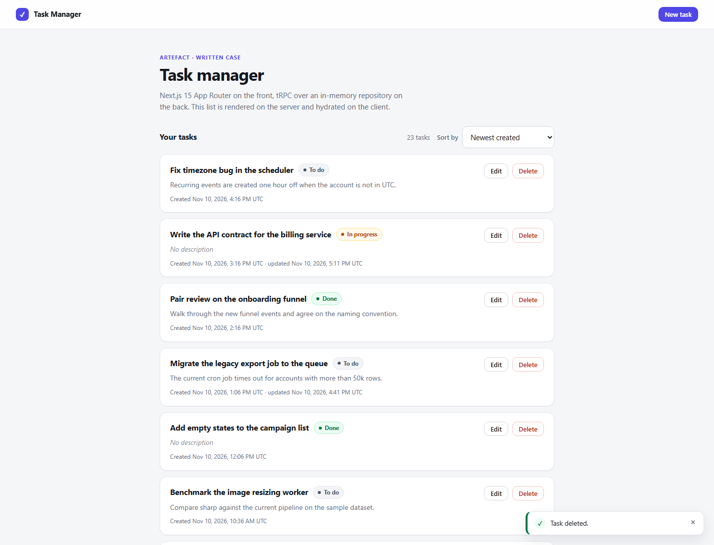
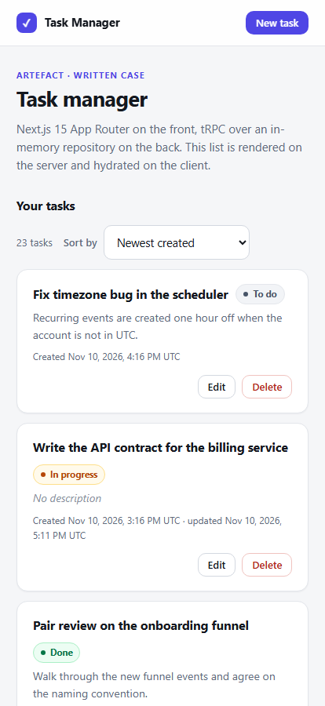
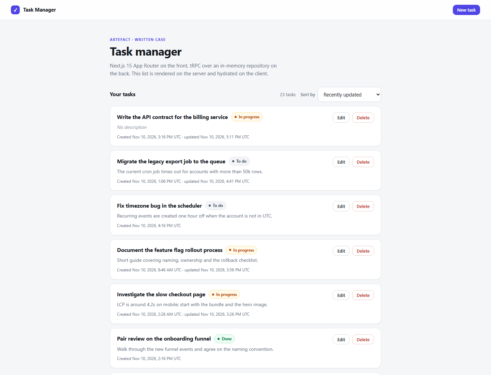

# Part 2 — Practical Case

**Repository:** https://github.com/phscezario/artefact-selective-process

## 1. What I built

I built a task management application covering all CRUD operations required by the case. The task list is rendered on the server, and I also implemented the infinite-scroll bonus.

The interface and documentation are in English, and the application uses fictional data. It can be started locally with:

```bash
npm install
npm run dev
```

### Technology stack

| Layer         | Technology                                         | Version       |
| ------------- | -------------------------------------------------- | ------------- |
| Framework     | Next.js (App Router, Server Components)            | 15.5          |
| UI            | React / React DOM                                  | 19.3          |
| API           | tRPC + TanStack React Query integration            | 11.27 / 5.107 |
| Validation    | Zod                                                | 4.6           |
| Serialization | superjson                                          | 2.2           |
| Tests         | Vitest                                             | 3.2           |
| Language      | TypeScript (`strict` + `noUncheckedIndexedAccess`) | 5.9           |
| Monorepo      | npm workspaces                                     | npm 10        |

The case specifies four task fields: `id`, `titulo` (required), `descricao` (optional) and `dataCriacao`. I kept those names as requested, added an optional `status` field (`todo`, `in_progress` or `done`) to make each task's state visible in the list, and a `dataAtualizacao` timestamp that follows the same naming convention.

`dataAtualizacao` starts equal to `dataCriacao` and is bumped on every edit. It gives the list a second sortable dimension (what changed most recently, regardless of when it was created) and lets the row show "updated" only when that actually happened.

The status defaults to `todo`, so creating a task with only the required fields still works.

## 2. Architecture

```text
┌────────────────────────────────────────────────────────────────────────────┐
│ frontend/ — Next.js 15, App Router                                         │
│                                                                            │
│  app/page.tsx              Server Component: prefetch + HydrateClient      │
│  app/tasks/new              Server Component: renders the form shell       │
│  app/tasks/[id]/edit        Server Component: calls tasks.getById          │
│  components/task-list       Client: useInfiniteQuery + delete mutation     │
│  components/task-form       Client: useTaskForm + create/update mutation   │
│  app/api/trpc/[trpc]        Route Handler: the HTTP API entry point        │
└───────────────────────────────────┬────────────────────────────────────────┘
                                   │ imports the workspace package
┌───────────────────────────────────▼────────────────────────────────────────┐
│ backend/ — @artefact/backend (no Next.js dependency)                       │
│                                                                            │
│  router.ts                 appRouter: tasks + health                       │
│  trpc.ts                   initTRPC, superjson, errorFormatter, timing     │
│  context.ts                per-request context, repository injection       │
│  modules/tasks/                                                            │
│    task.constants.ts       limits, status order and sort values            │
│    task.schema.ts          Zod inputs, limits and domain types             │
│    task.router.ts          list / getById / create / update / delete       │
│    task.repository.ts      TaskRepository interface + in-memory adapter    │
│    task.seed.ts            24 fictional tasks                              │
└────────────────────────────────────────────────────────────────────────────┘
```

I kept the backend in its own workspace package instead of tying its implementation directly to Next.js. It contains the tRPC router, validation schemas and `TaskRepository` interface, and has no dependency on the frontend framework.

Next.js exposes the router through a single route handler using the tRPC fetch adapter. Server Components can also call the router directly, in-process, so the server does not make an unnecessary HTTP request to its own API.

This keeps the deployment straightforward while maintaining a clear separation between the application and its transport layer. For example, the in-memory repository could be replaced by a PostgreSQL implementation without changing the task procedures. Likewise, the API could later be exposed through another server adapter without moving business rules into the frontend.

## 3. API and validation

The application exposes the tRPC API through:

```text
/api/trpc/*
```

| Procedure       | Type     | Input                                                             | Possible errors            |
| --------------- | -------- | ----------------------------------------------------------------- | -------------------------- |
| `tasks.list`    | Query    | `{ limit?: 1..50 (default 8), cursor?: string, sort?: TaskSort }` | `BAD_REQUEST`              |
| `tasks.getById` | Query    | `{ id }`                                                          | `NOT_FOUND`                |
| `tasks.create`  | Mutation | `{ titulo, descricao?, status? }`                                 | `BAD_REQUEST`              |
| `tasks.update`  | Mutation | `{ id, titulo?, descricao?, status? }` (at least one field)       | `BAD_REQUEST`, `NOT_FOUND` |
| `tasks.delete`  | Mutation | `{ id }`                                                          | `NOT_FOUND`                |
| `health`        | Query    | No input                                                          | —                          |

`TaskSort` is `created-desc` (default), `created-asc`, `updated-desc`, `titulo-asc` or `status-asc`. The value is validated by the same Zod enum the UI uses, so an unsupported order is rejected with `BAD_REQUEST` instead of silently falling back on the server.

The validation rules are defined in `task.schema.ts` and reused by the frontend and backend. The form uses `createTaskInput.safeParse` to provide immediate feedback, while the tRPC procedure validates the request again on the server.

The title is trimmed, required and limited to 120 characters. The description is trimmed and limited to 1,000 characters. An empty description is normalised to `null`, giving the application a consistent representation for a task without a description.

Errors are also handled explicitly. The tRPC `errorFormatter` adds a `fieldErrors` map when validation fails with a `ZodError`. This allows the frontend to identify the field that needs attention instead of displaying only a generic error.

For example, a validation response can include:

```json
{
  "error": {
    "json": {
      "data": {
        "fieldErrors": { "titulo": "Title is required." }
      }
    }
  }
}
```

Stack traces are available during development and removed in production. An unexpected server error is replaced by a generic message, so an internal detail never reaches the browser. When a task does not exist, the API returns `NOT_FOUND` with a message explaining that the task may have already been deleted. The edit page uses the same condition to render the Next.js not-found page.

The `dataCriacao` and `dataAtualizacao` fields remain JavaScript `Date` objects on both sides. I use superjson to preserve the date type during transport, avoiding manual conversion from ISO strings in the components.

### Pagination

The list endpoint uses cursor-based pagination. The `nextCursor` value contains the ID of the last task in the current page, and the next request continues from that position.

I chose this approach because tasks can be deleted while someone is browsing the list. With offset pagination, deleting an item between requests can shift the remaining records and cause an item to be skipped. Cursor-based pagination makes this scenario easier to handle. If a cursor refers to a task that has since been deleted, the implementation restarts from the first page.

## 4. Server-side rendering

The task list is rendered on the server, as required by the case. The request flow is:

1. Next.js renders `app/page.tsx` as a Server Component. The route declares `export const dynamic = 'force-dynamic'` because the in-memory store can change after a mutation. This ensures the list page is rendered dynamically instead of reusing stale static HTML.
2. The page calls `getQueryClient().prefetchInfiniteQuery(trpc.tasks.list.infiniteQueryOptions(...))`. `getQueryClient` uses React `cache`, allowing the page and nested components to share the QueryClient for that request.
3. The router is called in-process, so there is no HTTP round trip from the server to its own tRPC endpoint.
4. `HydrateClient` dehydrates the prefetched query data and passes it to the client tree through a `HydrationBoundary`.
5. The initial HTML already contains the task rows, status badges and formatted creation dates. The browser does not need to fetch the first page before displaying the list.
6. On the client, `TaskList` uses the same `infiniteQueryOptions`. TanStack Query can use the hydrated data for the initial render. The query is configured with a 30-second `staleTime` and `refetchOnWindowFocus: false`.
7. Create, update and delete operations run through `/api/trpc`. After a successful mutation, the relevant task-list query is invalidated so the displayed data and total are refreshed.

I also kept date formatting consistent between the server and browser. Dates use the `en-US` locale and the UTC time zone, avoiding differences caused by the server and user's local time zones during hydration.

The create page is a Server Component that renders the client-side form. The edit page retrieves the task on the server through `caller.tasks.getById` and passes its values to the form as `initialValues`. If the task no longer exists, the page calls `notFound()` rather than rendering an invalid form.

## 5. Behaviour and user experience

The list displays the task title, description, status and creation date, with eight items loaded per page. When a task has been edited, the row also shows when it was last updated.

### Ordering

The list can be ordered by creation (newest or oldest), last update, title or status. The chosen order lives in the URL (`/?sort=updated-desc`), so the server component prefetches exactly that view and the link can be shared or bookmarked.

The seed data makes this visible: eight of the 24 tasks were edited after being created, so "recently updated" produces a different order than "newest created". Status uses the workflow order (`todo`, `in_progress`, `done`) instead of alphabetical order, and title sorting ignores case.

Each order is implemented as a total order with the task `id` as the tiebreaker. Without it, two tasks with the same timestamp could swap places between two page requests.

### Infinite scroll

An `IntersectionObserver` watches a sentinel near the bottom of the list. Its `rootMargin` is set to `240px`, so the next page can start loading before the user reaches the end.

The sentinel is only rendered while another page is available. Once all tasks have been loaded, the interface displays a message indicating that the end of the list has been reached.

The observer is updated when the fetching state changes to avoid triggering duplicate requests.

### Loading, empty and error states

- **Loading:** `app/loading.tsx` displays skeleton rows during navigation. Infinite scrolling has a separate inline loading indicator.
- **Empty state:** When there are no tasks, the page displays a message and an action to create the first task.
- **Error state:** If loading fails, the list displays an error message and a retry action.

### Delete flow

Deleting a task requires an inline confirmation instead of using `window.confirm`. The selected row displays its own pending state while the request is running.

On success, the application displays a confirmation toast and invalidates the list query. If the API returns an error, an error toast is displayed instead. Keeping confirmation within the row avoids blocking the entire interface.

### Create and edit forms

Both operations use the same `TaskForm` component, with separate create and edit modes. Form state is managed with React hooks through `useTaskForm`, without adding a form library for this relatively small case.

The form includes:

- Client-side validation using the same Zod schema as the API.
- Field-level error messages, with `aria-invalid` and `aria-describedby`.
- Server validation errors mapped back to the relevant fields.
- A submitting state on the button, including a `Saving…` label and `aria-busy`.
- Success feedback, query invalidation and navigation back to the list.
- A character counter for the description and `maxLength` on both fields.
- `useId()` to associate input labels and IDs correctly.

I also included accessibility details such as semantic landmarks, visible focus indicators, `role="alert"` for field errors, `aria-live` for toast messages and support for `prefers-reduced-motion`.

The layout is responsive, with row actions moving below the task content on smaller screens.

## 6. Screenshots



_Figure 1 — The list page is server-rendered, and the initial response already contains the tasks._



_Figure 2 — Client-side validation displays the field error and an error toast._



_Figure 3 — The edit form receives its initial values from the server, while the mutation runs on the client._



_Figure 4 — The user confirms deletion inside the row, without a browser dialog._



_Figure 5 — Success feedback is displayed and the list is refreshed._



_Figure 6 — On smaller screens, the task actions move below the task content._



_Figure 7 — Ordering by last update, chosen in the list and reflected in the URL._

## 7. Tests and verification

The project provides a verification command:

```bash
npm run verify
```

It runs ESLint, a Prettier check, the TypeScript checks, the Vitest suites of both workspaces and the Next.js production build. CI runs this same command, so the local gate and the pipeline cannot drift.

The backend has 33 tests. Most of them exercise the real router with an injected repository, without HTTP or mocks. Four go through the same `fetchRequestHandler` adapter the app mounts at `/api/trpc`, because that is the only place where the promises of the wire can actually be verified: `dataCriacao` and `dataAtualizacao` arrive as `Date` objects (superjson) and a rejected input carries `fieldErrors`.

The tests cover:

1. Creating a task generates a unique ID, trims the title and normalises a whitespace-only description to `null`; the status defaults to `todo` when omitted, and both timestamps start equal.
2. An empty title is rejected with `BAD_REQUEST`; the exact title limit is accepted and one character more is rejected.
3. The same boundary check for the description (1000 accepted, 1001 rejected).
4. An unknown status is rejected.
5. Cursor pagination across three pages returns every item exactly once and ends with `nextCursor: null`; the list is ordered newest-first.
6. An unknown cursor falls back to the first page, and the limit defaults to 8 when omitted.
7. An invalid page size (0 or 51) is rejected.
8. Updating a task changes only the fields included in the request, trims the title, and rejects an update without any field.
9. Updating keeps `dataCriacao` and bumps `dataAtualizacao`.
10. An empty description clears the existing description.
11. Reading, updating and deleting a task that does not exist return `NOT_FOUND`.
12. Deleting a task succeeds once and returns `NOT_FOUND` when attempted again.
13. The seed data has 24 tasks, keeps both timestamps as `Date` objects and passes the entity schema.
14. A task returned to a caller cannot be used to mutate the store.
15. Sorting works for creation (both directions), last update, title (case-insensitive) and status (workflow order), and the default order is unchanged.
16. An unsupported sort value is rejected, and pagination keeps the requested order without repeating or skipping an item.
17. With the seeded data, ordering by creation and by last update produce different sequences.
18. Over HTTP: the dates survive the wire, invalid input returns `BAD_REQUEST` with `fieldErrors.titulo`, a missing task returns 404, and in production an unexpected error exposes neither its message nor its stack.

The frontend has 13 tests for the pure logic behind the list, the form and the error handling: the sort parser (including unknown values in the URL), the shared list input, the field-error mapping and the message extraction from a `TRPCClientError`.

I also checked the production build manually:

- **HTTP smoke test:** Against `npm start`, I tested create, read, update, list, delete, repeated delete and empty-title validation. I checked title trimming, description normalisation, date deserialization, `dataAtualizacao` being bumped by an update, `NOT_FOUND` on the second delete and `BAD_REQUEST` with `fieldErrors.titulo` for an empty title.
- **SSR check:** I inspected the raw HTML returned for `/` and for `/?sort=updated-desc`, and confirmed that each one starts with the task expected for that order. This verifies that the ordering is applied on the server and that the task content is present in the initial HTML response rather than being added only after a client-side request.
- **Infinite-scroll check:** Using Chrome DevTools Protocol, I confirmed that 16 rows were present after hydration and all 24 were loaded after scrolling, followed by the end-of-list message.

The `npm run verify` command completes successfully. The CI workflow runs the same command.

## 8. Running the application

For local development:

```bash
npm install
npm run dev
```

The application is available at `http://localhost:3000`.

To run the production build:

```bash
npm run build
npm start
```

To run with Docker:

```bash
docker compose up --build
```

The Docker setup uses a multi-stage build based on `node:22-alpine`. It separates dependency installation, the build stage and the runtime image. The final image contains the Next.js standalone output and starts it with `node frontend/server.js`, without including the source files, development dependencies or npm cache.

The CI workflow in `.github/workflows/ci.yml` runs on pushes and pull requests to `main`:

```text
npm ci → npm run verify
```

The full verification command is also available locally:

```bash
npm run verify
```

## 9. Trade-offs and possible next steps

Some decisions were made to keep the implementation aligned with the scope of the case. They also have limitations that would matter in a production application.

| Decision                                 | Reason                                                                      | Trade-off                                                                          |
| ---------------------------------------- | --------------------------------------------------------------------------- | ---------------------------------------------------------------------------------- |
| Backend as a workspace package           | Keeps one deployment while separating backend responsibilities from Next.js | The backend is not independently deployable yet                                    |
| tRPC instead of REST                     | Provides end-to-end types without maintaining a separate API contract       | Less suitable for non-TypeScript clients and public integrations                   |
| Shared Zod schemas                       | Keeps frontend and backend validation consistent                            | The validation schema is also included in the client bundle                        |
| superjson                                | Preserves `Date` values across the API boundary                             | Adds some serialization overhead                                                   |
| Cursor-based pagination                  | Handles changes to the list more predictably while users browse             | The cursor is an implementation detail that the UI does not interpret              |
| Sorting evaluated per request            | One implementation covers every order without extra indexes or caching      | Editing an item between two pages can move it out of the current cursor window     |
| In-memory repository behind an interface | Meets the requirements without introducing a database                       | Data is lost on restart, and the store is limited to a single application instance |
| Hand-written CSS                         | Avoids adding another dependency for a small application                    | Reusable styling utilities would be useful as the interface grows                  |

If I had more time to extend the project, I would prioritise the following:

1. Add PostgreSQL through another `TaskRepository` implementation. The existing interface and context injection provide a starting point for this change.
2. Add authentication through `createContext`, which already receives the request headers.
3. Introduce rate limiting at the procedure level.
4. Consider optimistic updates for task deletion.
5. Add Playwright tests for the main user flows.
6. Replace the basic timing log with OpenTelemetry instrumentation.
7. Add a task detail page with support for comments.

For the scope of this case, I focused on implementing the requested functionality, keeping the code organised and making the main flows verifiable without introducing infrastructure that the application does not need.
